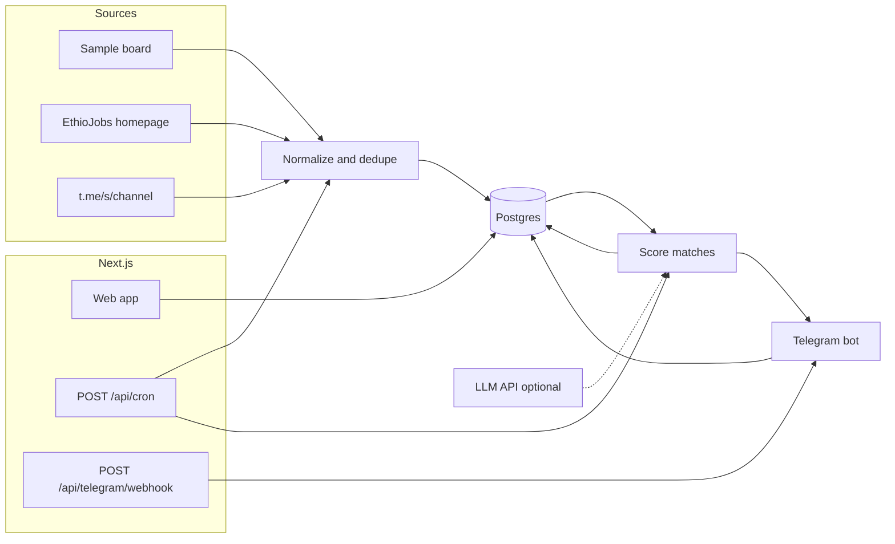

# Sera

Sera (ሥራ) matches Ethiopian job postings to a seeker’s profile and sends the reason, plus the apply link, on Telegram. The web app is where someone edits a profile, reviews matches, and operates the sources.

It is built to run cheaply: one Node process, one Postgres database, and no paid API unless you add a key.

## What you can do today

- Sign in as one of two seeded people, or with the Telegram login widget once a bot exists.
- Read a PDF or DOCX CV. The file bytes are checked and discarded. Only extracted text is stored, and it is not shown on the admin page.
- Score every active job with rules plus a hashed text embedding. The same inputs always produce the same score when no model key is set.
- Filter matches by city, remote, job type, and minimum score.
- Turn on a 30-day premium flag through a payment stub (299 ETB). Premium unlocks a cover-letter draft and three CV notes. No money moves.
- Ingest the sample board, the public EthioJobs homepage, and public Telegram channel previews.

## Architecture



Matching is deterministic without `LLM_API_KEY`:

1. Normalize a posting into title, company, city, remote, job type, level, deadline, skills, and language.
2. Drop duplicates with a fingerprint of normalized title, company, and city. Amharic cities such as አዲስ አበባ collapse to the same city as “Addis Ababa”.
3. Score skills, field, experience, location, job type, and freshness, then blend that with cosine similarity of a hashed embedding.
4. Scores of 74 and above are instant alerts. Scores of 50 and above wait for the digest. A passed deadline is pushed below the digest line.

If `LLM_API_KEY` is set, instant alerts can get a rewritten “why” sentence, and premium users can rewrite a cover letter. Failures fall back to the template.

## Local setup

Requirements: Node 22, PostgreSQL 16.

```bash
docker compose up -d
cp .env.example .env
npm install
npx prisma migrate deploy
npm run db:seed
npm test
npm run dev
```

Open [http://127.0.0.1:3847](http://127.0.0.1:3847). Sign in as Hana Tadesse (software engineering student, also the demo admin) or Dawit Bekele (junior accountant). Their matches are different on purpose.

`npm run dev` listens on port 3847.

Useful commands:

| Command                                        | What it does                                                  |
| ---------------------------------------------- | ------------------------------------------------------------- |
| `npm test`                                     | Parsing, dedupe, scoring, CV checks, payments, Telegram login |
| `npm run lint`                                 | ESLint                                                        |
| `npm run format`                               | Prettier                                                      |
| `npm run typecheck`                            | `next typegen` and `tsc --noEmit`                             |
| `npm run ingest -- sample`                     | Re-read the sample board                                      |
| `npm run ingest -- ethiojobs`                  | Pull the public EthioJobs homepage                            |
| `npm run ingest -- telegram:ethiojobsofficial` | Pull one public channel preview                               |
| `npm run match`                                | Rescore every profile                                         |
| `npm run worker`                               | Ingest, score, and alert on a timer                           |
| `npm run bot`                                  | Long-poll the bot. Do not run this and a webhook together     |

## Telegram bot

1. Talk to [@BotFather](https://t.me/BotFather). Send `/newbot` and copy the token into `TELEGRAM_BOT_TOKEN`.
2. Set `TELEGRAM_BOT_USERNAME` and `NEXT_PUBLIC_TELEGRAM_BOT_USERNAME` to the bot’s username without `@`.
3. For the login widget, send BotFather `/setdomain` and use the host you will serve. Telegram requires a public HTTPS domain for the widget.
4. Local alerts while you develop: `npm run bot`. The process long-polls. Commands:
   - `/start` welcome, in English or Amharic based on the saved locale
   - send a PDF or DOCX CV
   - or one message with `Field:`, `Skills:`, `Level:`, `City:`, `Remote:`, `Types:`
   - `/profile` walks those questions
   - `/matches` top jobs
   - `/alerts instant|digest|both|off`
   - `/language en` or `/language am`
   - `/upgrade` explains premium
5. Production should use a webhook instead of polling. Set `TELEGRAM_WEBHOOK_SECRET` and call:

```bash
curl "https://api.telegram.org/bot$TELEGRAM_BOT_TOKEN/setWebhook" \
  -d "url=https://YOUR_HOST/api/telegram/webhook" \
  -d "secret_token=$TELEGRAM_WEBHOOK_SECRET"
```

### Channel ingestion

Bots cannot read a channel’s history unless the bot is an admin, and even then history is limited. Sera reads the public web preview at `https://t.me/s/<channel>`, which needs no bot membership. Set `TELEGRAM_CHANNELS` to a comma-separated list. `ethiojobsofficial` is a working default.

Private channels are out of scope. A later MTProto user-account client could be a new `JobSource`. Do not put a personal Telegram session string in this app until that design is explicit.

## Deploy

A small production layout:

- Postgres on Neon, Supabase, or any host that gives a `DATABASE_URL`.
- One Node service with `npm install`, `npx prisma migrate deploy`, `npm run build`, `npm start`.
- A second process, or an external cron, for ingestion:

```bash
curl -X POST -H "Authorization: Bearer $CRON_SECRET" https://YOUR_HOST/api/cron
curl -X POST -H "Authorization: Bearer $CRON_SECRET" "https://YOUR_HOST/api/cron?digest=1"
```

Run the digest call once each morning. 05:00 UTC is 08:00 in Addis Ababa. The worker uses `DIGEST_UTC_HOUR=5` for the same schedule.

Set `DEMO_MODE=false` before real seekers use the site. The seed creates `hana.tadesse@sera.local` as an admin so you can click around locally. Do not leave demo sign-in on in production, and do not treat that account as your real admin. Promote a Telegram user with SQL if you need an operator:

```sql
UPDATE "User" SET role = 'admin' WHERE "telegramId" = 'YOUR_ID';
```

Required production environment:

- `DATABASE_URL`
- `SESSION_SECRET` of at least 32 characters. The app refuses to sign sessions without it when `NODE_ENV=production`.
- `NEXT_PUBLIC_APP_URL`, the public https origin
- `CRON_SECRET`
- `DEMO_MODE=false`
- `TELEGRAM_BOT_TOKEN`, `TELEGRAM_WEBHOOK_SECRET`, `NEXT_PUBLIC_TELEGRAM_BOT_USERNAME`

Optional: `LLM_API_KEY`, `LLM_BASE_URL`, `LLM_MODEL`, `EMBEDDING_MODEL`, `TELEGRAM_CHANNELS`.

## Payments

`PAYMENT_PROVIDER` defaults to `stub`. Checkout creates a pending row and a confirm page that flips the user to premium for 30 days. Chapa’s initialize and verify calls run only when `PAYMENT_PROVIDER=chapa` and `CHAPA_SECRET_KEY` is set. Telebirr’s class is the integration point: it refuses to run until merchant keys exist, and it still does not sign a fabric token. Do not point either provider at live keys until you have tested with the provider’s sandbox and a real callback URL.

## CV and secrets

- Uploads must be PDF or DOCX, at most 4 MB, and the magic bytes must match the extension. Path characters in the name are rejected.
- Bytes are parsed in memory. They are not written to disk.
- Extracted text is capped at 12,000 characters on the user’s row. Admin lists show the file name only.
- Logs redact fields whose names look like tokens, secrets, or CV text.
- A single process allows five CV uploads per user per minute. Put a shared limiter in front before you run more than one web instance.
- Session cookies are httpOnly, `SameSite=Lax`, and `Secure` in production.

## Tests and CI

GitHub Actions runs lint, Prettier, typecheck, unit tests, `prisma migrate deploy`, and `next build` against Postgres 16.

The tests cover normalization (English, Amharic, Ethiopian dates), dedupe, match ordering, CV rejection, the EthioJobs and Telegram parsers, the payment stub, and Telegram login verification.

## Roadmap

1. Create the bot, set the webhook, and set `DEMO_MODE=false`.
2. Add the Telegram channels students actually use, and confirm EthioJobs still exposes jobs in the homepage payload.
3. Share the bot in a few university groups. Watch which matches people open.
4. Add an LLM key only after the deterministic scores look right. It rewrites reasons. It does not replace the score.
5. Sandbox Chapa at 299 ETB. Wire the paid callback before offering it. Telebirr comes after fabric-token signing is implemented and reviewed.
6. Keep the free tier useful. Charge for the letter and the CV notes, not for seeing the job.
